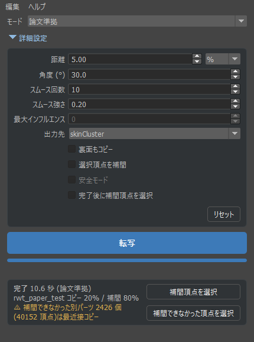

# Maya Robust Skin Weights Transfer

体(スキン済みメッシュ)のスキンウェイトを、服へ転写する Maya ツールです。
[Robust Skin Weights Transfer via Weight Inpainting](https://www.dgp.toronto.edu/~rinat/projects/RobustSkinWeightsTransfer/)(Abdrashitov et al., SIGGRAPH Asia 2023)を論文ベースで実装しています。

- 体に近く、向きもそろっている服の頂点 → 体のウェイトをそのままコピー
- それ以外(ゆったりした布、股・脇まわりなど) → コピーした頂点から滑らかに補間

Maya 標準の `Copy Skin Weights`(最近接)で起きやすい、股で布が左右に引き裂かれる・脇が胴に引っ張られるといった破綻を抑えます。



## 特長

- 服がスキニングされていなくても OK(体と同じジョイントで自動バインド)
- Maya で **体 → 服** の順に選ぶだけ。服は複数まとめて転写可能
- **Ctrl+Z 1回で元に戻せる**(複数の服を転写した場合も1回)
- 2つのモード
  - **論文準拠**: 論文の公式 Python 実装と同じ処理だけを行う(比較・検証の基準)
  - **拡張・小パーツ対応**: 点群補間・頂点の溶接・別パーツの救済などを加えた実用向けモード。ボタン・ポーチなども下の布と一緒に動く
- 出力先を **skinCluster** / **ngSkinTools2 のレイヤー**(最近接コピー + 補間結果 + マスク)から選択
- 7万頂点クラスの衣装で 10〜20 秒程度

## 2つの版

| | 通常版(`scripts/` + `plug-ins/`) | 1ファイル版(`single_file/`) |
|---|---|---|
| 導入 | `install.py` をドラッグ&ドロップ | ファイル1つをコピー |
| Undo | Ctrl+Z 1回で戻せる(プラグインを使う) | **できない**(転写すると Undo 履歴もクリア) |
| プラグインの許可 | 初回に必要 | 不要 |
| Python | 3 | 2.7 / 3(Maya 2022 の Python 2 モード対応) |
| numpy / scipy | Maya の Python に入れる | Python 3 の mayapy に入れる(下記) |

両方を同時に入れないでください(どちらも `robust_weight_transfer` という名前で読み込まれます)。転写の結果は同じです。

### 1ファイル版のセットアップ(会社の PC など)

1. numpy / scipy を **Python 3 の mayapy** に pip で入れます(コマンドプロンプトで実行。パスは Maya のバージョンに合わせて変更)
   ```bat
   "C:\Program Files\Autodesk\Maya2022\bin\mayapy.exe" -m pip install --user numpy scipy
   ```
   - Python 2 モードの Maya 2022 でも、入れる先は `mayapy.exe`(Python 3.7)です。`mayapy2.exe` ではありません
   - pip が Python 3.7 に合うバージョン(numpy 1.21 / scipy 1.7 系)を自動で選びます
2. `single_file/robust_weight_transfer.py` を `Documents/maya/scripts/` にコピーします
3. Maya のスクリプトエディタ(Python)で実行します
   ```python
   import robust_weight_transfer as rwt
   rwt.show()
   ```
   シェルフに登録する場合は `rwt.install_shelf()`

計算のしくみ: Maya の Python で numpy / scipy を読めればそのまま Maya の中で計算します。読めない場合(Python 2 モードなど)は、Maya に付属する Python 3 の mayapy を別プロセスで起動して計算します。どちらでも結果は同じです(検証済み)。
ツールの **ヘルプ → 計算環境を確認** で、使われる Python と numpy / scipy の有無を確認できます。mayapy が見つからない場合は **ヘルプ → Python 3 の場所を指定**(または環境変数 `RWT_PYTHON3`)で指定してください。

## 動作環境

| Maya | 状態 | 必要なもの |
|---|---|---|
| 2027 | 動作確認済み(Windows) | scipy |
| 2023〜2026 | 動作する見込み(未検証) | scipy(numpy が無ければ numpy も) |
| 2022 | 未検証(1ファイル版は Python 2 モードにも対応) | numpy, scipy(1.7 系) |

- **numpy**: 最近の Maya には同梱(2027 は同梱を確認済み)。無い場合はインストーラーが pip で入れます
- **scipy**: 追加インストールが必要(インストーラーが pip で入れます)
- **ngSkinTools2**: 任意。「ngSkin レイヤー」出力を使うときだけ必要(Maya 2027 は同梱。それ以前は [ngskintools.com](https://www.ngskintools.com/) から)

## インストール

1. このリポジトリをダウンロードして、好きな場所に置きます
   - 緑の **Code** ボタン → **Download ZIP** → 展開
   - または `git clone https://github.com/pontya/maya-robust-weight-transfer.git`
2. Maya を起動し、フォルダ内の **`install.py` をビューポートにドラッグ&ドロップ**します
   - Maya モジュールとして登録(`Documents/maya/modules/RobustWeightTransfer.mod`)
   - numpy / scipy が無ければ、pip でインストールするか確認されます(インターネット接続が必要)
   - 現在のシェルフに **RWT** ボタンを追加
3. scipy をインストールした場合は Maya を再起動します

> 初回の転写時に、Undo 用プラグイン `rwt_undo_cmd.py` の読み込み許可を求められることがあります。**許可(ロード)** を選んでください。

### 手動でインストールする場合

1. scipy を Maya の Python に入れます(コマンドプロンプトで実行。パスは Maya のバージョンに合わせて変更)
   ```bat
   "C:\Program Files\Autodesk\Maya2027\bin\mayapy.exe" -m pip install --user scipy
   ```
   Maya 2022 の場合:
   ```bat
   "C:\Program Files\Autodesk\Maya2022\bin\mayapy.exe" -m pip install --user "numpy<1.22" "scipy<1.8"
   ```
2. `Documents/maya/modules/` に `RobustWeightTransfer.mod` を作り、次の内容を書きます(パスは置いた場所に変更)
   ```
   + RobustWeightTransfer 1.0 C:/path/to/maya-robust-weight-transfer
   scripts: scripts
   plug-ins: plug-ins
   ```
3. Maya を再起動

## 使い方

1. Maya で **体(スキン済み)→ 服** の順に選択します(服は Ctrl / Shift で複数追加可)
2. シェルフの **RWT** ボタン、または次のコマンドでツールを開きます
   ```python
   import robust_weight_transfer as rwt
   rwt.show()
   ```
3. **モード** を選んで **転写** を押します

バインドポーズの状態で実行してください。各項目の説明は、マウスオーバーのツールチップと **ヘルプ → 各項目の説明** にあります。

スクリプトから使う場合:

```python
import robust_weight_transfer as rwt
rwt.transfer("body", "cloth", mode="paper")              # 論文準拠(既定値)
rwt.transfer("body", "cloth", mode="extended", interp="pointcloud",
             dist_abs=5.0, allow_flip=True, smooth_iter=0, max_influences=8)  # 拡張
```

## モード

| 処理 | 論文準拠 | 拡張・小パーツ対応 |
|---|---|---|
| 補間 | 三角形メッシュの cot ラプラシアン | 点群ラプラシアン(独自の簡易実装) |
| 頂点の溶接(UV の境目で割れた頂点) | しない | する |
| コピーできる頂点が無い別パーツ | 補間せず最近接コピーの値を入れ、件数を報告 | 距離だけで基準点を補って補間 |
| スムース | 公式と同じ範囲・順序 | 空間的な距離で範囲を決め、まとめて更新 |
| インフルエンス数の制限・小さい値の削除 | しない | する |
| 頂点法線 | 面積重み(公式の libigl と同じ) | Maya の頂点法線 |
| 選択頂点を補間(マスク) | 守る | 守る(救済処理でも基準点にしない) |

設定はモードごとに保存されます。どちらのモードも、最後に負の値を 0 にして正規化します(論文 3.2 の処理)。

## 設定項目

| 項目 | 内容 | 論文準拠の既定値 | 拡張の既定値 |
|---|---|---|---|
| 距離 | この距離以内の頂点は体からコピー。単位は % (服の対角長に対する割合) か cm | 5 % | 5 cm |
| 角度 | 体と服の向きがこれ以上ずれた頂点は補間に回す | 30° | 30° |
| スムース回数 / 強さ | 補間部分の境目をなじませる | 10 / 0.20 | 0(オフ) |
| 最大インフルエンス | 1頂点あたりのジョイント数の上限(0 = 体と同じ) | 使わない | 8 |
| 出力先 | skinCluster / ngSkin レイヤー | skinCluster | skinCluster |
| 裏面もコピー | 厚み・裏地のある服の内側の面もコピー対象に(論文の任意オプション) | オフ | オン |
| 選択頂点を補間 | 選択した服の頂点を必ず補間(論文 3.4 のマスク) | オフ | オフ |
| 安全モード | 壊れたメッシュで結果が乱れるとき用 | 使わない | オフ |

角度の 30° は公式 Python 実装の値です。**論文本文では 35°** と書かれています。拡張モードの既定値は Blender アドオン [robust-weight-transfer](https://github.com/sentfromspacevr/robust-weight-transfer) の既定値を参考にしていますが、点群補間などは別実装のため、同じ結果にはなりません。

## 論文の実装との対応

- 論文 3.1 最近接点マッチング、3.2 ウェイトの補間(Q = −L + LM⁻¹L)、3.3 スムース、3.4 マスクを実装
- 「論文準拠」は公式実装 [rin-23/RobustSkinWeightsTransferCode](https://github.com/rin-23/RobustSkinWeightsTransferCode) の **Python 版**(`src/utils.py`)に合わせています
  - L = 2 × cotmatrix(Python 版と同じ。C++ 版は L = cotmatrix で、結果が変わります)
  - 質量行列 = ボロノイ混合面積、頂点法線 = 面積重み
- 公式の球→平面データ(同じ入力)で比較した結果
  - マッチング結果: 一致
  - 補間・スムース: Python 上で誤差 1e-13 以下で一致
  - Maya 上で端から端まで実行: 最終ウェイトの差 最大 1.2e-8(Maya の頂点座標が単精度のため)
- 実際の衣装では、Maya と libigl の最近接点計算の違いなどで、公式実装と結果が変わる可能性があります(未検証)
- UV の境目などで頂点が分かれたメッシュ(FBX 由来の衣装など)では、論文準拠は溶接しないため、分かれた部分の多くが「コピーできる頂点が無い別パーツ」として報告されます。実用には拡張モードを使ってください

## 既知の制限

- 拡張モードの点群補間は簡易な自前実装です(Blender版が使う robust_laplacian とは別物)。服全体の補間方法が変わるため、左右の脚・脇・重なった布など、近いけれど別々に動かしたい場所もつながりやすくなります
- 拡張モードの溶接は同じ位置の頂点をまとめるため、同じ位置にある別レイヤーもまとめられることがあります
- 最大インフルエンスは小さい順に打ち切ります(周囲となじませながら削る処理はありません)
- 通常版は、ウェイトの書き込みに Undo 用の小さなプラグイン(`plug-ins/rwt_undo_cmd.py`)を使います
- 1ファイル版は Maya 2027(Python 3)で、Maya 内の計算と別プロセスの計算が同じ結果になることを確認しています。Maya 2022 の Python 2 モードでは未検証です(Python 2 の文法チェックのみ)

## アンインストール

`Documents/maya/modules/RobustWeightTransfer.mod` とダウンロードしたフォルダを削除し、シェルフの RWT ボタンを消してください。

## ライセンス

MIT License(`LICENSE` を参照)

論文:

```bibtex
@inproceedings{abdrashitov2023robust,
  author    = {Abdrashitov, Rinat and Raichstat, Kim and Monsen, Jared and Hill, David},
  title     = {Robust Skin Weights Transfer via Weight Inpainting},
  booktitle = {SIGGRAPH Asia 2023 Technical Communications},
  year      = {2023},
  doi       = {10.1145/3610543.3626180}
}
```
